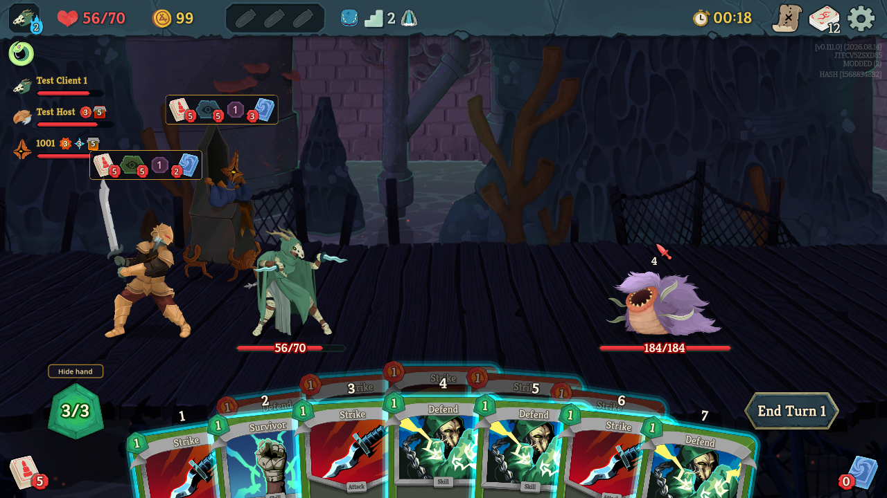
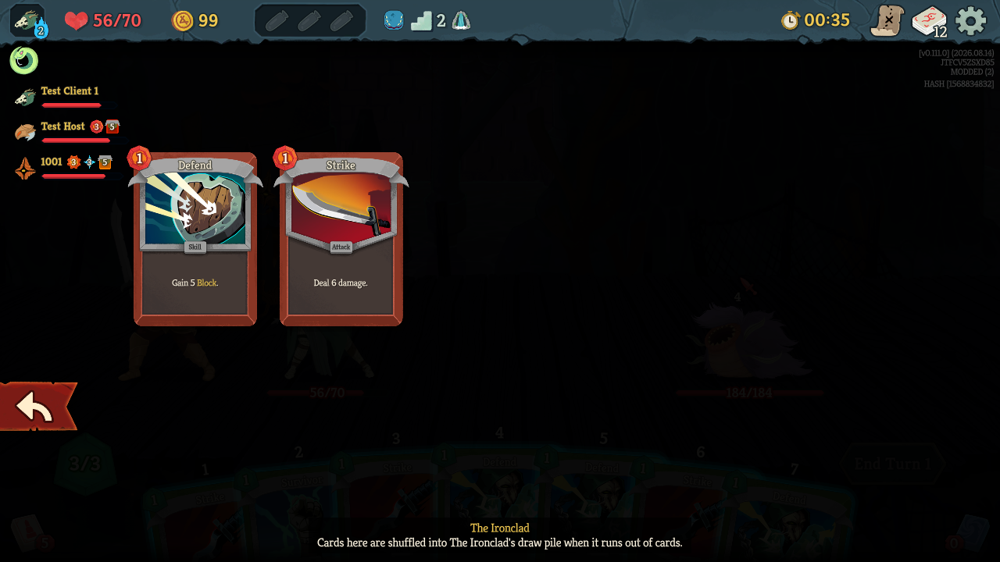
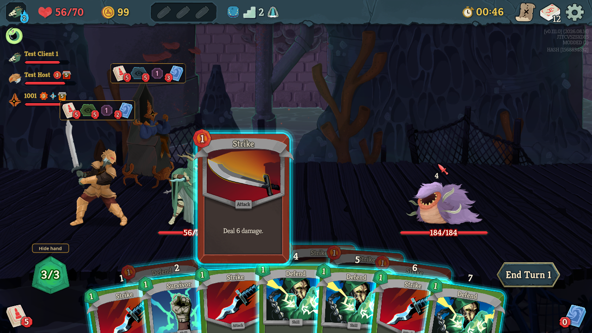
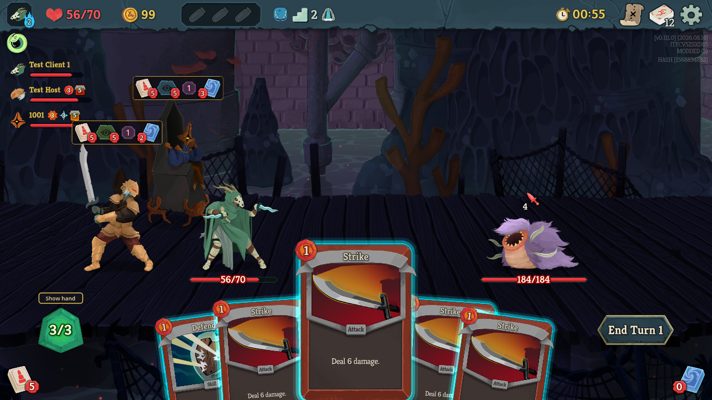
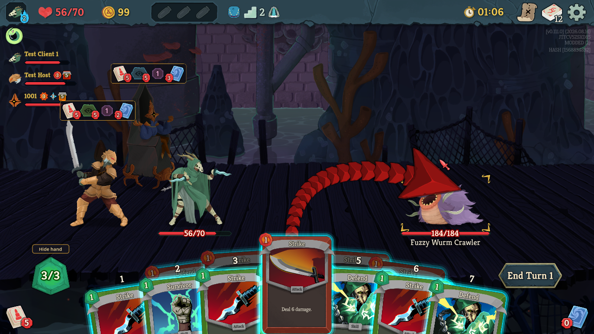
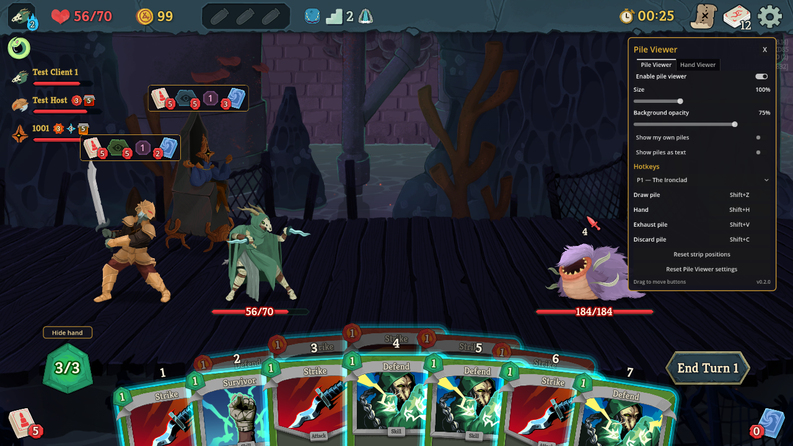

# Spire2 Pile Viewer

Slay the Spire 2 co-op mod: see your teammates' draw, exhaust, and discard piles, and their hand.

- Each teammate gets a strip with live pile counts. **Click** a pile to open it.
- **Drag** a strip to move it.
- Hotkeys: Shift+Z / V / C open teammate 1's draw / exhaust / discard pile (Ctrl+ for teammate 2,
  Ctrl+Shift+ for teammate 3). Rebind in F1, to keys or extra mouse buttons. The game's own hotkeys win.

## Hand Viewer

- Your teammate's hand is shown behind yours, using the game's own cards with their live costs and playable glow.
- **Hover** (or click) one of their cards to see it in full.
- **Drag** one of their cards onto an enemy to preview its numbers against that enemy, from their state.
- Click the **eye** in a strip to switch teammates or hide their hand (Shift+H, Ctrl+H, Ctrl+Shift+H).
- **Hide hand** (or H) hides your own hand to read theirs.

## Settings (F1)

## Install

Subscribe on the [Steam Workshop](https://steamcommunity.com/sharedfiles/filedetails/?id=3818266065), or copy `Spire2PileViewer.dll` and `Spire2PileViewer.json` into `<Slay the Spire 2>/mods/Spire2PileViewer/`.

## Build

Needs the .NET 9 SDK and the game installed (set `Sts2Dir` in `src/Spire2PileViewer.csproj` if it isn't in
the default Steam folder): `dotnet build src/Spire2PileViewer.csproj`, then `scripts/install-local.ps1`.
Publish: `scripts/prepare-workshop.ps1`, then MegaCrit's
[ModUploader](https://github.com/megacrit/sts2-mod-uploader) `upload -w workshop` (Steam running).
Development notes: [PILE_VIEWER.md](PILE_VIEWER.md).

## Credits

Architecture adapted from **BetterSpire2** by **jdr**
([Workshop](https://steamcommunity.com/sharedfiles/filedetails/?id=3747530215),
[source](https://github.com/AlecRichardson/BetterSpire2)). Local multiplayer testing via Alchyr's
[ModTemplate-StS2](https://github.com/Alchyr/ModTemplate-StS2).
