# Exploration: odd hands and situations (2026-10-15)

Played through status cards, curses, X cost, afflictions, upgrades, full hands, generated cards, an empty hand, a dead
teammate, a teammate in a card choice and a multi-enemy fight with 4 players, using the new `explore` suite
(`dev-autotest-mp.ps1 -Suite explore`: scripted setups, saved game frames and notes, not a pass/fail gate).

## TL;DR

| | |
|---|---|
| **Fixed** | Closeup tooltips ended up partly **behind** the full-size card. |
| **Fixed** | Stacked, nearly full teammate hands covered the **End Turn** button (drawn over it *and* took its clicks). |
| **Works** | Statuses, curses, X cost, afflictions, upgrades, 10-card hands, generated cards, empty hand, dead teammate, card choice, several enemies. The host's view matched each teammate's own screen card for card (cost, text, keywords) in every run. |
| **Questions** | Dragging an unplayable card; the text-list popup's position; a dead teammate stays "viewed". See the end. |

## Bug 1: tooltips behind the closeup (fixed)

The game lines a card's tooltips up beside it once, then only moves them with the card. Our closeup is resized and placed
after that (from its smaller, tilted spot in the fan), so the text box ended up under the full-size card. Now the
tooltips are lined up again whenever the closeup is placed. Check: tooltips beside the card, hand shown and hidden
(fails without the fix: tooltip starts 37 units inside the card).

| Before | After |
|---|---|
| 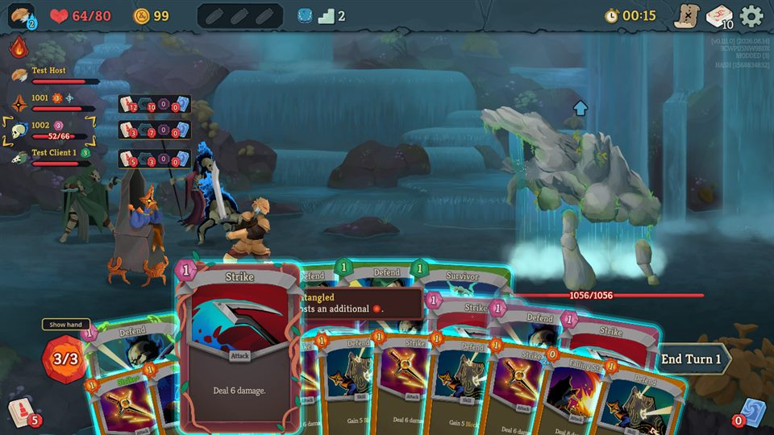 | 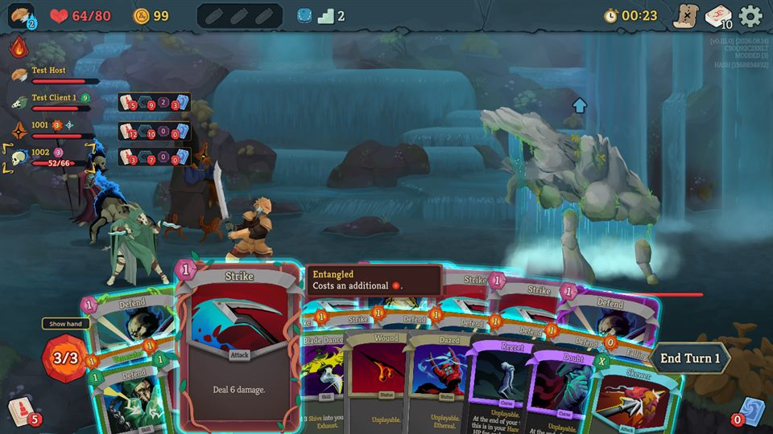 |

## Bug 2: stacked hands covered End Turn (fixed)

Two or three nearly full teammate hands reach the End Turn button. The hand comes after the button among the combat UI's
children, so the cards were drawn over its left part and a click there opened a teammate card's closeup instead of
ending your turn. While any teammate hand is shown, the button is now moved to just after the hand (moved back
otherwise): it's drawn above the teammate cards and gets the clicks there. Raising its z-index alone isn't enough: Godot
draws by z-index but picks the clicked control by tree order. Check: with hands stacked, the button takes the mouse
across its width.

| Before (Skewer covers "End") | After |
|---|---|
| 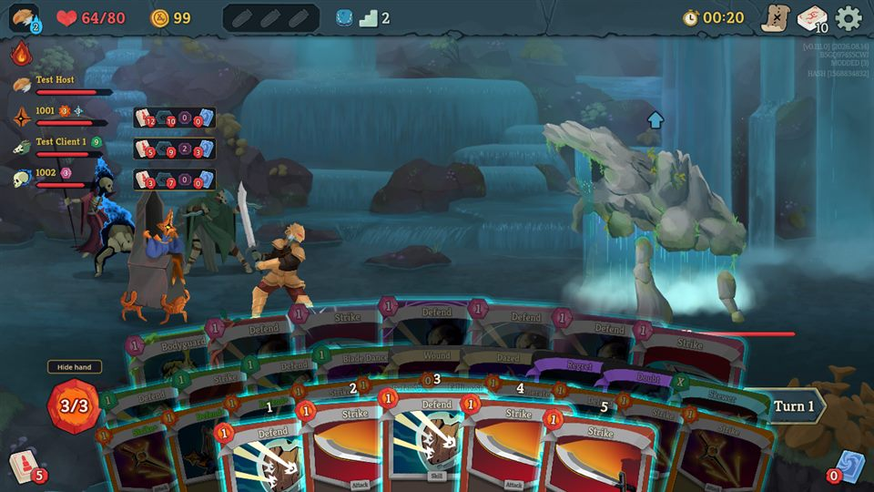 | 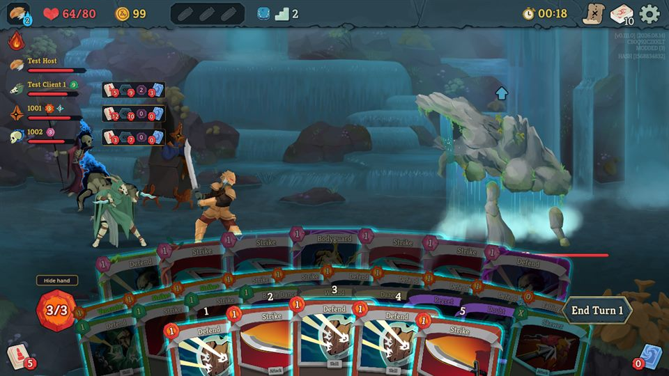 |

## Works as expected

| | |
|---|---|
| 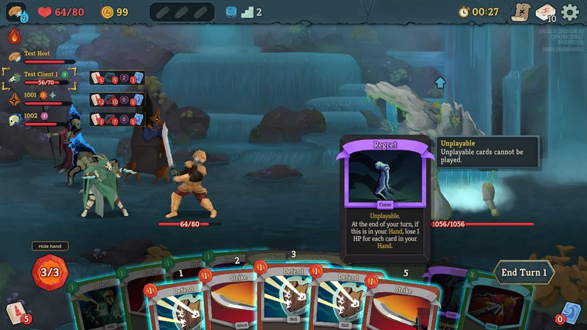 Curse / status: no cost gem, no glow, closeup with the game's "Unplayable" tooltip. | 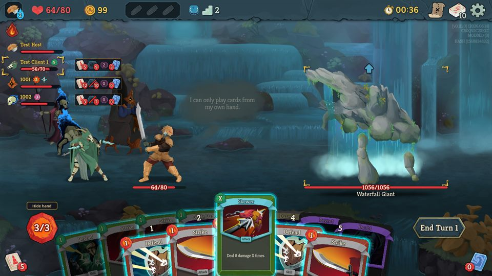 X cost (Skewer): "X" cost, aims like any attack. |
| 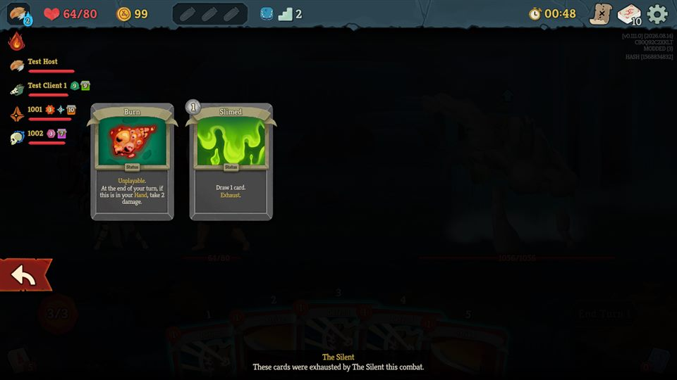 Exhaust pile with statuses: "exhausted by The Silent this combat". | 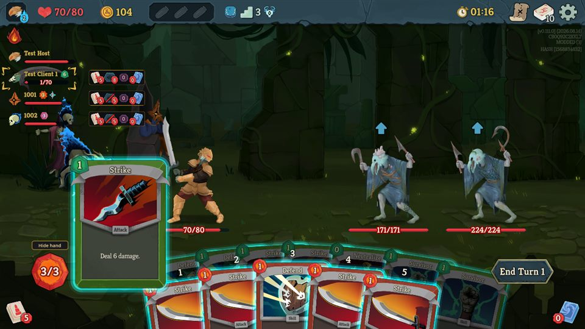 Teammate choosing a card to discard (Survivor): their hand stays viewable, hover and aim work. |
| 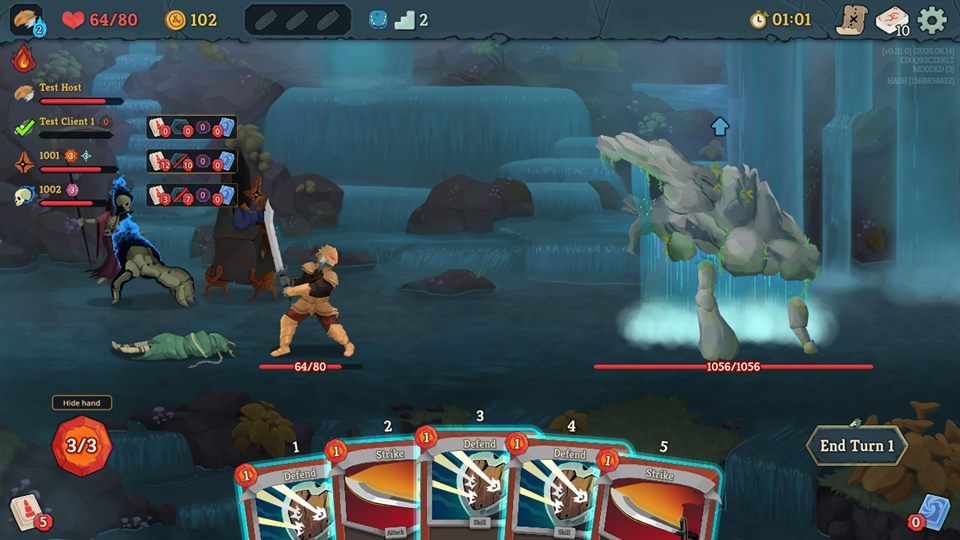 Dead teammate: Pile Viewer 0/0/0/0, no cards. Next fight they're back (1 HP). | 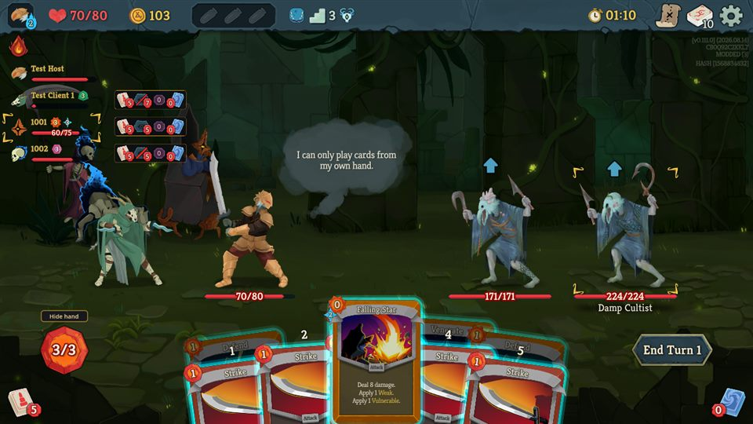 Cultists (2 enemies): aims at each. |

**Cost colors.** A raised cost is drawn the game's way: the Tangled debuff (Vine Shambler) entangles the owner's attacks
and makes them cost 1 more — shown as a blue **2**, the game's color for a raised cost (red is only for "can't afford").
The "Entangled" marker on its own (as in the tooltip screenshots above, put there with the debug console) changes
nothing, on the owner's screen too. The host-vs-owner comparisons now include the cost color.

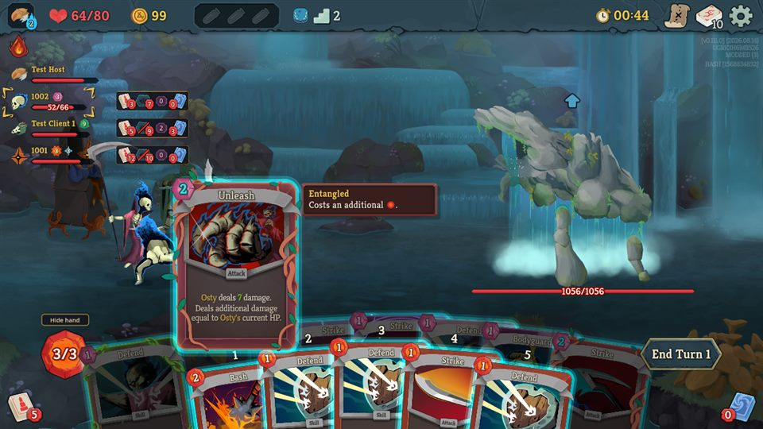

Also checked: afflictions (Bound, Entangled, Hexed, Ringing, Tainted) show the same text and cost as on the owner's
screen; 3 upgraded cards; Blade Dance's Shiv appears live and hovers fine; an empty hand shows nothing and doesn't break
the stack; pile screens with 3 / 2 / 12 cards.

## Questions (not changed)

1. **Dragging an unplayable card** (Wound, Regret) into the play zone: it floats there and letting go says "I can only
   play cards from my own hand." The game, for your own unplayable card, snaps it back at the play zone with its reason.
   Mirror that (snap back + the game's reason), or keep the drag for consistency?

   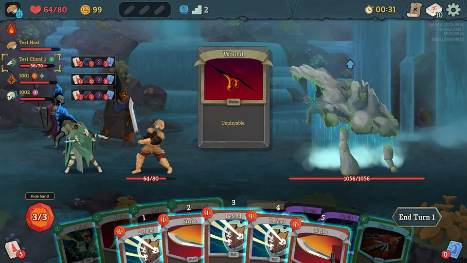
2. **Show piles as text**: the popup opens above the Pile Viewer and can cover the Pile Viewers of the players listed
   above it. Fine, or open it below / to the right?

   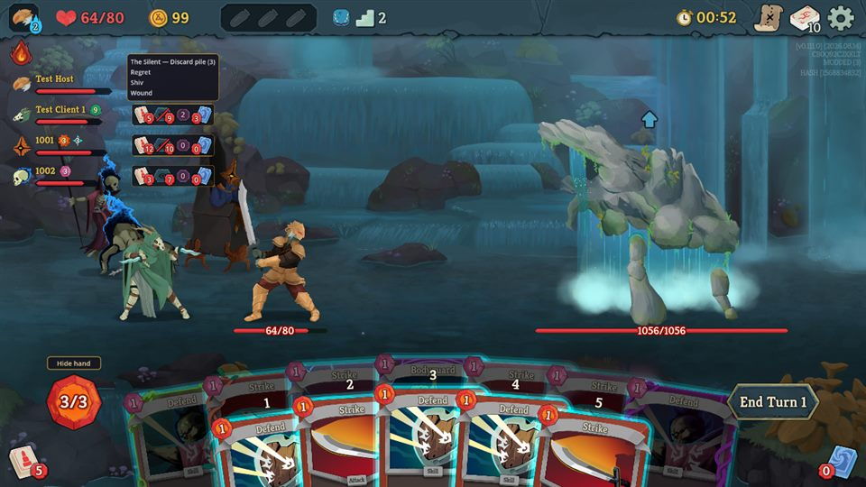
3. **A dead teammate stays "viewed"**: their (empty) hand keeps its slot in the stack and the eye stays plain. Leave it
   (they're back next fight), or skip dead teammates?
4. With a full 10-card hand, the rightmost card's top corner now sits **under** End Turn (drawn and clicked as the
   button). That card is still easy to hover a little further left.

Not ours: the debug console's `card` into a full hand drops the card silently, and console actions wait while a player is
in a card choice (test setup only).
